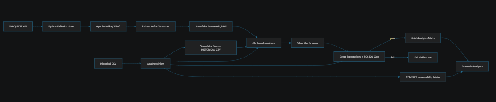
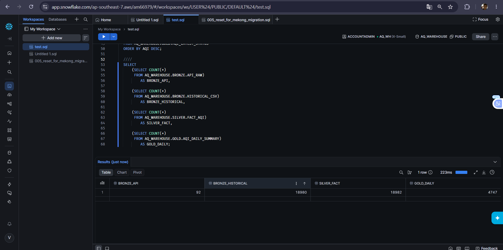
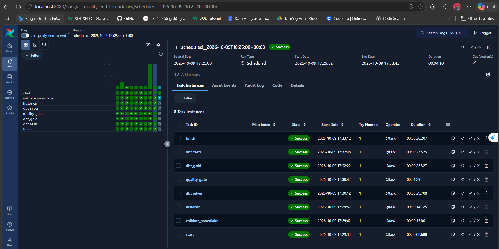
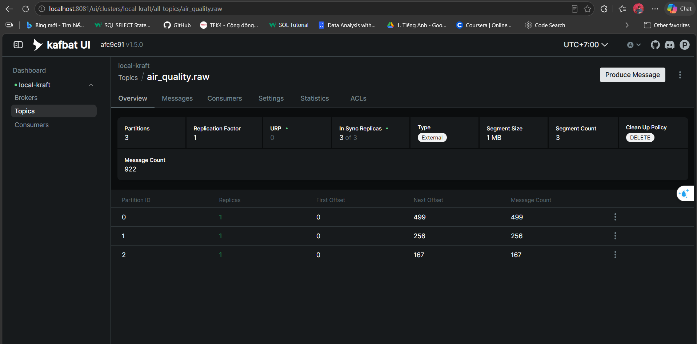
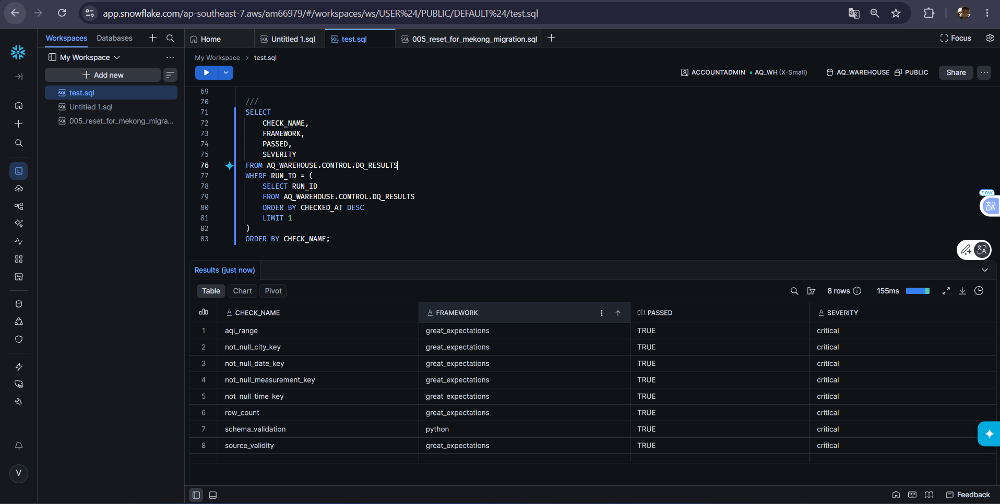
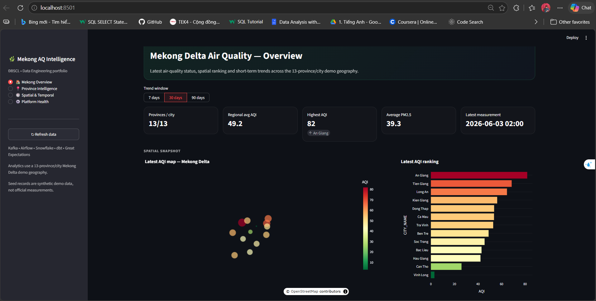
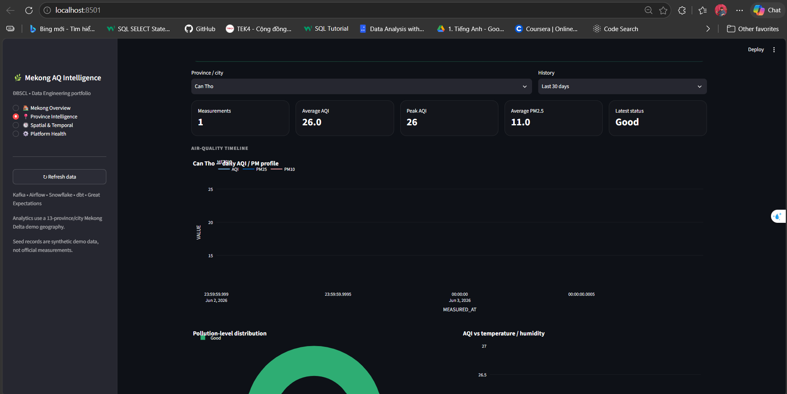
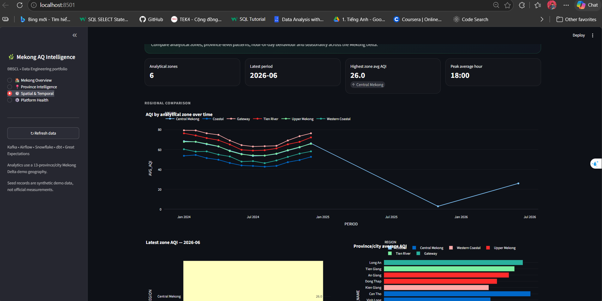
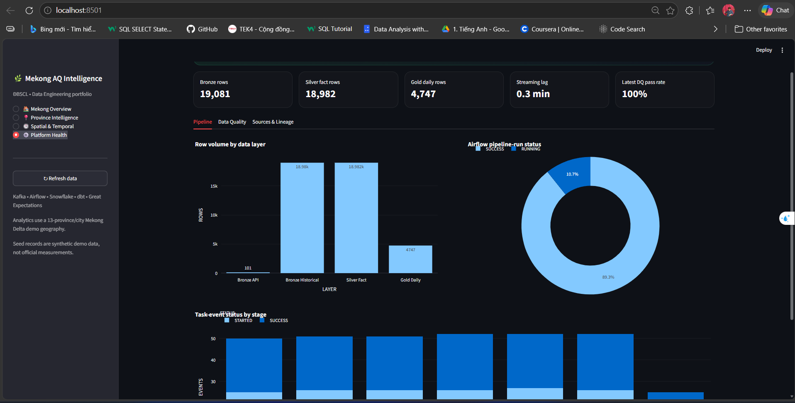

# 🌿 Mekong Delta Air Quality Data Platform

Nền tảng Data Engineering end-to-end thu thập, xử lý, kiểm tra chất lượng và trực quan hóa dữ liệu chất lượng không khí khu vực Đồng bằng sông Cửu Long.

Project được xây dựng theo hướng **portfolio Data Engineer**, kết hợp **streaming + batch ingestion** với Apache Kafka, Apache Airflow, Snowflake, dbt, Great Expectations, Docker Compose và Streamlit.

> **Lưu ý dữ liệu:** phần historical seed trong project là dữ liệu synthetic phục vụ demo/kiểm thử/portfolio, không phải số liệu quan trắc chính thức. Dữ liệu live từ WAQI vẫn giữ timestamp do upstream source trả về.

---

## 1. Mục tiêu

Project mô phỏng một data platform có khả năng:

- thu thập dữ liệu chất lượng không khí theo luồng;
- nạp dữ liệu lịch sử theo batch;
- lưu raw data trong Snowflake;
- transform theo kiến trúc Bronze / Silver / Gold;
- kiểm tra chất lượng dữ liệu trước khi publish;
- điều phối pipeline bằng Airflow;
- theo dõi pipeline run, task status, freshness và DQ;
- trực quan hóa dữ liệu ĐBSCL bằng Streamlit.

---

## 2. Kiến trúc hệ thống

```text
                       WAQI API
                          │
                          ▼
                Python Kafka Producer
                          │
                          ▼
                 Apache Kafka (KRaft)
                  topic: air_quality.raw
                          │
                          ▼
                Python Kafka Consumer
                          │
                          ▼
                      Snowflake
                ┌──────────────────┐
                │      BRONZE      │
                │ API_RAW          │
                │ HISTORICAL_CSV   │
                └────────┬─────────┘
                         │
                         ▼
                   Apache Airflow
                         │
                         ▼
                      dbt Silver
                         │
                         ▼
          Great Expectations + SQL DQ Gate
                         │
                         ▼
                      dbt Gold
                         │
                         ▼
                Streamlit Dashboard
```

Luồng batch:

```text
Historical CSV
     │
     ▼
Python Batch Loader
     │
     ▼
Snowflake BRONZE.HISTORICAL_CSV
```

### Ảnh minh chứng kiến trúc



---

## 3. Công nghệ sử dụng

| Thành phần | Công nghệ |
|---|---|
| Programming | Python 3.12 |
| Streaming | Apache Kafka |
| Kafka mode | KRaft |
| Orchestration | Apache Airflow |
| Data Warehouse | Snowflake |
| Transformation | dbt Core + dbt-snowflake |
| Data Quality | Great Expectations + SQL |
| Metadata DB | PostgreSQL |
| Dashboard | Streamlit + Plotly |
| Infrastructure | Docker Compose |
| CI/CD | GitHub Actions |
| Snowflake Auth | RSA Key Pair |

---

## 4. Phạm vi dữ liệu ĐBSCL

Project tập trung vào 13 tỉnh/thành theo phạm vi ĐBSCL truyền thống:

```text
An Giang
Bạc Liêu
Bến Tre
Cà Mau
Cần Thơ
Đồng Tháp
Hậu Giang
Kiên Giang
Long An
Sóc Trăng
Tiền Giang
Trà Vinh
Vĩnh Long
```

Để phục vụ analytics, project nhóm dữ liệu thành một số **vùng phân tích**:

```text
Upper Mekong
Central Mekong
Coastal
Western Coastal
Tien River
Gateway
```

> Các tên vùng trên chỉ là grouping dùng trong project, không phải phân loại hành chính chính thức.

---

## 5. Nguồn dữ liệu

### Streaming

```text
WAQI API
→ Kafka Producer
→ Kafka
→ Kafka Consumer
→ Snowflake BRONZE.API_RAW
```

Kafka consumer sử dụng manual offset commit và chỉ commit sau khi transaction Snowflake thành công.

```text
At-least-once delivery
```

### Historical Batch

```text
historical_air_quality_mekong_delta.csv
→ Python Batch Loader
→ BRONZE.HISTORICAL_CSV
```

Các file đã load được ghi nhận tại:

```text
CONTROL.LOADED_FILES
```

giúp tránh load lại cùng một file nhiều lần.

---

## 6. Source freshness và Pipeline freshness

Project phân biệt hai loại timestamp:

```text
MEASURED_AT
= thời điểm nguồn ghi nhận phép đo

INGESTED_AT
= thời điểm pipeline nhận dữ liệu
```

Ví dụ:

```text
Latest measurement : 03/06/2026
Last ingestion      : 09/10/2026
```

Trường hợp này không có nghĩa pipeline lỗi. Pipeline vẫn ingest dữ liệu mới, nhưng upstream source có thể đang trả về measurement cũ.

Đây là một phần quan trọng của monitoring data pipeline.

---

## 7. Snowflake Medallion Architecture

### Bronze

```text
BRONZE.API_RAW
BRONZE.HISTORICAL_CSV
```

Mục tiêu:

- lưu dữ liệu gần nguồn;
- giữ metadata ingestion;
- hỗ trợ replay/debug;
- tránh transform quá sớm.

### Silver

```text
SILVER.STG_API_RAW
SILVER.STG_HISTORICAL

SILVER.DIM_DATE
SILVER.DIM_TIME
SILVER.DIM_CITY
SILVER.DIM_STATION

SILVER.FACT_AQI
```

Star schema:

```text
                  DIM_DATE
                     │
DIM_CITY ─────── FACT_AQI ─────── DIM_TIME
                     │
                DIM_STATION
```

Silver chịu trách nhiệm:

- chuẩn hóa schema;
- convert datatype;
- chuẩn hóa timestamp;
- mapping tỉnh/thành;
- deduplicate;
- kết hợp streaming và historical;
- tạo fact/dimension.

### Gold

```text
GOLD.AQI_DAILY_SUMMARY
GOLD.AQI_CITY_RANKING
GOLD.STATION_SUMMARY
GOLD.AQI_HOURLY_PATTERN
GOLD.AQI_SEASONAL_SUMMARY
GOLD.AQI_LATEST_STATUS
GOLD.AQI_POLLUTANT_SUMMARY
GOLD.AQI_REGION_SUMMARY
```

Gold phục vụ trực tiếp cho analytics và dashboard.

### Ảnh minh chứng Snowflake


---

## 8. Airflow Pipeline

DAG chính:

```text
air_quality_end_to_end
```

Task flow:

```text
start
  ↓
validate_snowflake
  ↓
historical
  ↓
dbt_silver
  ↓
quality_gate
  ↓
dbt_gold
  ↓
dbt_tests
  ↓
finish
```

Airflow chịu trách nhiệm:

- kiểm tra Snowflake;
- load historical CSV;
- chạy dbt Silver;
- chạy Data Quality Gate;
- build Gold;
- chạy dbt tests;
- lưu pipeline observability metrics.

### Ảnh minh chứng Airflow



---

## 9. Kafka Streaming

Topic chính:

```text
air_quality.raw
```

Producer:

```text
WAQI API
→ validate response
→ add queried city
→ build event
→ publish Kafka
```

Consumer:

```text
Kafka
→ parse event
→ batch insert Snowflake
→ commit Snowflake
→ commit Kafka offset
```

Malformed records có thể được lưu tại:

```text
CONTROL.REJECTED_EVENTS
```

### Ảnh minh chứng Kafka



---

## 10. Data Quality

Project kết hợp:

```text
Great Expectations
+
SQL validation
```

Một số check chính:

```text
table not empty
schema validation
minimum row count
AQI range
source validity
critical null rate
duplicate measurement key
referential integrity
13-province coverage
no non-Mekong city
freshness
```

Kết quả lưu tại:

```text
CONTROL.DQ_RESULTS
```

Nếu critical check fail:

```text
quality_gate = FAILED
→ Gold không được build tiếp
```

### Ảnh minh chứng Data Quality



---

## 11. Observability

Các bảng control:

```text
CONTROL.PIPELINE_RUNS
CONTROL.PIPELINE_TASK_EVENTS
CONTROL.PIPELINE_METRICS
CONTROL.DQ_RESULTS
CONTROL.REJECTED_EVENTS
CONTROL.LOADED_FILES
```

Theo dõi:

- pipeline success / failed;
- task execution status;
- Bronze / Silver / Gold row counts;
- ingestion lag;
- data quality history;
- rejected events;
- batch files đã xử lý.

---

# 12. Dashboard

Dashboard được gom thành 4 trang để tránh phân mảnh.

## 12.1 Mekong Overview

Nội dung:

- số tỉnh/thành có dữ liệu;
- Regional Average AQI;
- Highest AQI;
- Average PM2.5;
- Latest Measurement;
- bản đồ ĐBSCL;
- AQI ranking;
- trend 7 / 30 / 90 ngày;
- AQI vs PM2.5;
- so sánh vùng phân tích.




---

## 12.2 Province Intelligence

Cho phép drill-down từng tỉnh/thành.

Nội dung:

- Measurements;
- Average AQI;
- Peak AQI;
- Average PM2.5;
- latest pollution status;
- AQI / PM2.5 / PM10 trend;
- pollution-level distribution;
- AQI vs temperature / humidity;
- hourly AQI profile;
- source coverage.




---

## 12.3 Spatial & Temporal Analysis

Nội dung:

- regional AQI trend;
- province ranking;
- Province × Month heatmap;
- Province × Hour heatmap;
- seasonal pattern;
- peak-hour analysis.




---

## 12.4 Platform Health

Nội dung:

- Bronze / Silver / Gold rows;
- streaming lag;
- Airflow run status;
- task status;
- DQ score;
- source lineage;
- source coverage.




---

# 13. Cấu trúc project

```text
vietnam-air-quality-data-platform/
│
├── airflow/
│   └── dags/
│       ├── air_quality_pipeline.py
│       └── observability_pipeline.py
│
├── config/
│   └── config.yaml
│
├── dashboard/
│   └── app.py
│
├── data/
│   └── sample/
│
├── dbt_air_quality/
│   ├── models/
│   ├── macros/
│   ├── dbt_project.yml
│   └── profiles.yml
│
├── kafka/
│   ├── producer/
│   └── consumer/
│
├── quality/
│   └── run_quality.py
│
├── scripts/
│   ├── bootstrap_snowflake.py
│   ├── generate_keypair.py
│   ├── generate_seed.py
│   └── verify_setup.py
│
├── snowflake/
│   └── sql/
│
├── src/
│   └── air_quality_platform/
│
├── docs/
│   └── images/
│
├── tests/
├── docker-compose.yml
├── Dockerfile.airflow
├── Dockerfile.app
├── .env.example
└── README.md
```

---

# 14. Hướng dẫn chạy

## Clone repo

```powershell
git clone <YOUR_REPOSITORY_URL>
cd vietnam-air-quality-data-platform
```

## Tạo `.env`

Copy:

```text
.env.example
```

thành:

```text
.env
```

Các biến chính:

```env
WAQI_TOKEN=

SNOWFLAKE_ACCOUNT=
SNOWFLAKE_USER=
SNOWFLAKE_DATABASE=AQ_WAREHOUSE
SNOWFLAKE_WAREHOUSE=AQ_WH
SNOWFLAKE_ROLE=SYSADMIN

SNOWFLAKE_PRIVATE_KEY_PATH=.secrets/rsa_key.p8
SNOWFLAKE_PRIVATE_KEY_PASSPHRASE=

AIRFLOW_UID=50000
```

Không commit:

```text
.env
.secrets/
```

## Generate RSA key

```powershell
python scripts\generate_keypair.py
```

## Bootstrap Snowflake

```powershell
python scripts\bootstrap_snowflake.py
```

## Generate seed

```powershell
python scripts\generate_seed.py
```

## Start

```powershell
docker compose up -d
```

Kiểm tra:

```powershell
docker compose ps
```

---

# 15. Local Services

| Service | URL |
|---|---|
| Airflow | http://localhost:8080 |
| Kafka UI | http://localhost:8081 |
| Streamlit | http://localhost:8501 |

---

# 16. Log hữu ích

Kafka Producer:

```powershell
docker compose logs -f kafka-producer
```

Kafka Consumer:

```powershell
docker compose logs -f kafka-consumer
```

Airflow:

```powershell
docker compose logs -f airflow-scheduler
```

Streamlit:

```powershell
docker compose logs -f streamlit
```

---

# 17. Verify environment

```powershell
python scripts\verify_setup.py
```

---

# 18. Dừng project

```powershell
docker compose down
```

Không dùng:

```powershell
docker compose down -v
```

nếu muốn giữ named volumes local.

---

# 19. Điểm kỹ thuật nổi bật

Project thể hiện:

- streaming ingestion;
- batch ingestion;
- Kafka producer / consumer;
- KRaft;
- consumer groups;
- manual offset commit;
- at-least-once delivery;
- idempotent batch loading;
- Snowflake Data Warehouse;
- Bronze / Silver / Gold;
- dimensional modeling;
- dbt transformations;
- dbt tests;
- Airflow orchestration;
- Great Expectations;
- SQL Data Quality;
- source freshness;
- pipeline freshness;
- observability;
- lineage;
- Docker Compose;
- Streamlit analytics.

---


# 20. Trạng thái hiện tại

```text
Kafka Streaming        ✅
Snowflake Bronze       ✅
Airflow Orchestration  ✅
dbt Silver             ✅
Data Quality Gate      ✅
dbt Gold               ✅
Streamlit Dashboard    ✅
```

---

# 21. Hướng phát triển

- alert Slack / email khi pipeline hoặc DQ fail;
- source freshness theo từng station;
- anomaly detection;
- AQI forecasting;
- cloud deployment;
- Infrastructure as Code;
- mở rộng CI/CD;
- bổ sung monitoring station;
- tách rõ live dataset và synthetic demo dataset.

---

# 👨‍💻 Tác giả

**Vỏ Văn Tài**

Định hướng:

```text
Data Engineering
Data Science
AI Engineering
```

GitHub:

```text
taiiswibu
```

---

## License

Project phục vụ mục đích học tập, nghiên cứu và portfolio.
