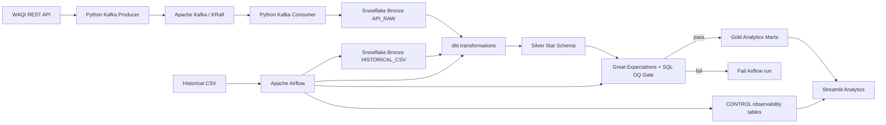
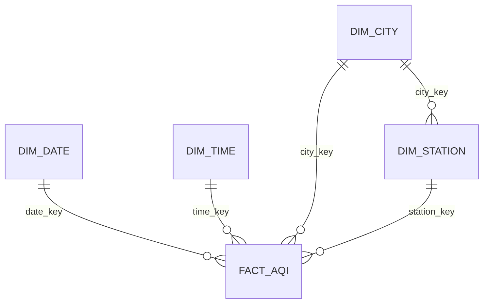

# Architecture

## Responsibility boundaries

- **Kafka**: streaming transport and consumer offsets; it does not orchestrate warehouse transformations.
- **Airflow**: workflow orchestration, retries, scheduling and failure visibility.
- **Snowflake**: cloud warehouse and Medallion storage layers.
- **dbt**: SQL transformation graph, dimensional modeling and schema tests.
- **Great Expectations**: reusable data-quality expectations; critical failures block Gold.
- **Streamlit**: portfolio analytics and operational monitoring UI.
- **Docker Compose**: reproducible local infrastructure for Kafka and Airflow.

## Data model

